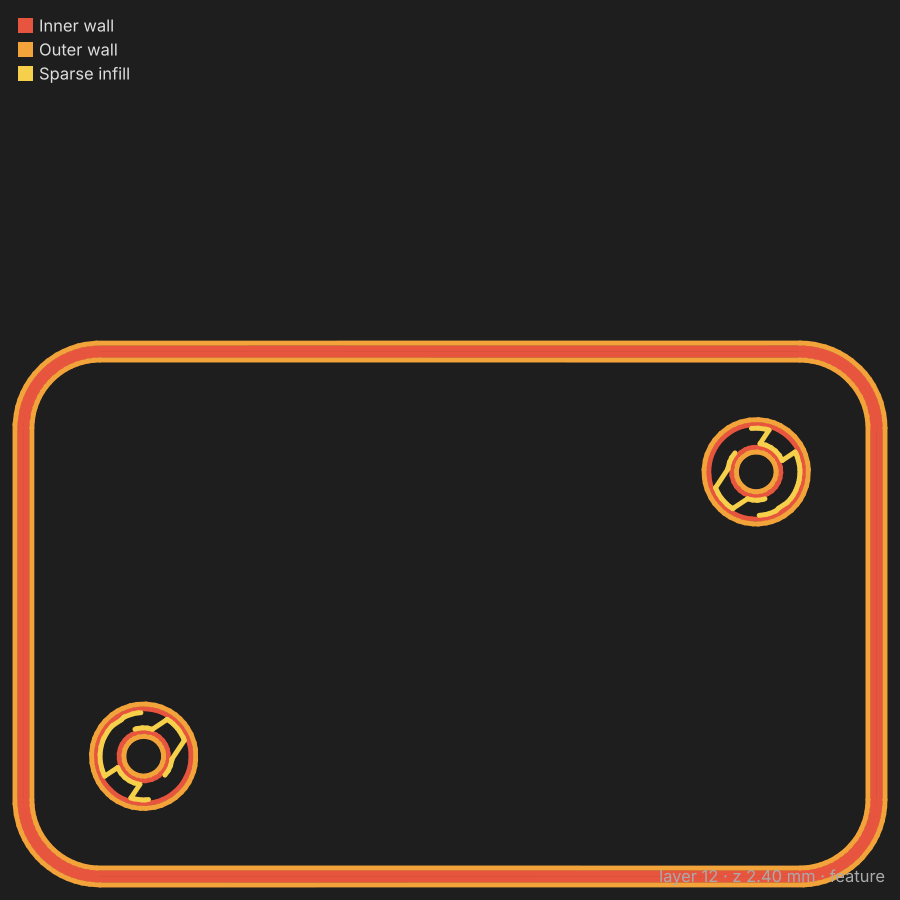

<!-- SPDX-License-Identifier: LGPL-2.1-or-later -->
# Agent Link for OrcaSlicer

> Not affiliated with or endorsed by the OrcaSlicer project. Get OrcaSlicer itself from its [official repository](https://github.com/OrcaSlicer/OrcaSlicer).

- [What it is](#what-it-is)
- [What you need](#what-you-need)
- [Install](#install)
- [First steps](#first-steps)
- [Screenshots](#screenshots)
- [What an agent can do with it](#what-an-agent-can-do-with-it)
- [Troubleshooting](#troubleshooting)
- [Privacy](#privacy)
- [Uninstall](#uninstall)
- [Licence](#licence) and [Credits](#credits)

How it works inside, with a diagram: [docs/workflow/](https://github.com/jamesK1000011/AgentLink-OrcaSlicer/blob/main/docs/workflow/README.md).

## What it is

Agent Link for OrcaSlicer lets an AI agent, such as Claude, use OrcaSlicer for you.
OrcaSlicer is a slicer: it turns a 3D model into G-code, the instructions a 3D printer follows.
The agent can make and change OrcaSlicer projects (`.3mf`), paint supports or seams,
build calibration prints, slice with OrcaSlicer's own command line, and read the G-code back layer by layer.
It works headless: the OrcaSlicer window does not need to be open, and it does not take your mouse or screen.
Starting a print is always your decision.

It is an add-on for [Agent Link for FreeCAD](https://github.com/jamesK1000011/AgentLink-FreeCAD).
It can also run alone, as its own small MCP server (MCP, the Model Context Protocol, is how an agent uses a program).

### Who it is for

- People who 3D print with OrcaSlicer and want to ask for a print in plain
  words ("slice this with 0.2 mm layers and supports only under the overhang").
- People who design in FreeCAD with
  [Agent Link for FreeCAD](https://github.com/jamesK1000011/AgentLink-FreeCAD),
  and want their bodies sliced and checked for strength without leaving the
  conversation.

You do not need to know OrcaSlicer's settings by heart. You do not need FreeCAD.

### It runs beside OrcaSlicer, not inside FreeCAD

This is not a FreeCAD workbench. It has no menus or panel in FreeCAD, and it
is not listed in FreeCAD's Addon Manager. It runs OrcaSlicer as a separate
program and reads and writes its files.

## What you need

- **OrcaSlicer**, from its [releases](https://github.com/OrcaSlicer/OrcaSlicer/releases). On a Mac, put it in Applications.
- **Python 3.9 or newer.** On a Mac, the extension finds one: Homebrew's, python.org's, the Xcode command line tools', or FreeCAD's own.
- **An MCP client**, for example Claude Desktop or Claude Code.
- **For FreeCAD bodies:** [Agent Link for FreeCAD](https://github.com/jamesK1000011/AgentLink-FreeCAD) and FreeCAD 1.0 or later (1.1 recommended).

## Install

Pick one.

### With Agent Link for FreeCAD (easiest)

1. Install [Agent Link for FreeCAD](https://github.com/jamesK1000011/AgentLink-FreeCAD#install) with its Claude Desktop extension.
2. Install OrcaSlicer.
3. Start a new chat in Claude Desktop.

The Agent Link extension's launcher installs this add-on for you into FreeCAD's `Mod` folder, as `OrcaLink`,
at the commit its tests passed with. Agent Link then finds `orcalink/agentlink_families.py`
and adds the orca tools to its own tool list. You do not need the separate extension for this.

With Agent Link for FreeCAD but without its Claude Desktop extension (for example Claude Code, or Linux),
put a copy in FreeCAD's `Mod` folder as `OrcaLink` and restart FreeCAD.
To find the folder, type `FreeCAD.getUserAppDataDir()` in FreeCAD's Python console (the `Mod` folder is inside it).

```
git clone https://github.com/jamesK1000011/AgentLink-OrcaSlicer "<FreeCAD user folder>/Mod/OrcaLink"
```

### As its own Claude Desktop extension (Mac)

1. Install OrcaSlicer.
2. Get `orcaslicer-agentlink.mcpb` from a release of this repository, or build it with `mcpb/build.sh`.
3. Double-click the file. Claude Desktop asks you to install it.
4. Start a new chat.

The extension finds Python and OrcaSlicer in `/Applications`.
At each start it fetches the newest version of this repository when it has changed.
It talks to Claude only over its own pipes and opens no network port.

Its settings in Claude Desktop:

- **Output folder**: where projects, G-code and exports go (`~/AgentLink` by default).
- **OrcaSlicer**: the path to OrcaSlicer's program, only if it is not in `/Applications`.
- **Keep it up to date**: fetch the newest version at each start (on by default).

### Any other MCP client

1. Get a copy of this repository:

   ```
   git clone https://github.com/jamesK1000011/AgentLink-OrcaSlicer
   ```

2. Add the companion server to your client's MCP settings. Put the real path of your copy in `args`:

   ```json
   {
     "mcpServers": {
       "orcaslicer": {
         "command": "python3",
         "args": ["/path/to/AgentLink-OrcaSlicer/orcalink_server.py", "--out", "~/AgentLink"]
       }
     }
   }
   ```

   On Windows, use `python` (or the full path of `python.exe`) for `command`.
   Without `--out`, files go to `~/Documents/AgentLink`.

3. Restart the client.

OrcaSlicer is found where it is installed. To use another copy, set
`AGENTLINK_ORCASLICER` to its program. Bambu Studio is found the same way,
with `AGENTLINK_BAMBUSTUDIO`.

## First steps

Start a new chat. Try these prompts, one at a time.

1. "Slice the box for my printer with 0.2 mm layers. How long does it take, and how much filament?"

   The agent makes an OrcaSlicer project, slices it, and reads the G-code back.
   It tells you the print time and the filament in grams and millimetres. The files go to the output folder (`~/AgentLink` by default).

2. "Add supports only under the overhang, then slice again."

   The agent paints supports on the faces that point down and slices again. It tells you what changed.

3. "Make a temperature tower for PETG."

   The agent builds OrcaSlicer's temperature calibration print as a project, ready to slice.

With FreeCAD, say which body to slice: "Slice the bracket from FreeCAD."

## Screenshots

<!-- screenshots: still to take: Claude Desktop with the extension listed (not taken: it shows the account); a sliced plate in the OrcaSlicer preview; a calibration project -->



*Layer 12 of a sliced tray, drawn by gcode_read from the G-code (inner wall, outer wall, sparse infill).*

## What an agent can do with it

The list is generated from the tool definitions by `tools/gen_readme_tools.py`.
Tools in the **orca** group are the same under Agent Link for FreeCAD, where
bodies go in by name and faces are painted by FreeCAD face. The others come
only with the companion server; Agent Link has its own.

<!-- tools:begin (generated by tools/gen_readme_tools.py) -->
| Tool | Group | What it does |
|---|---|---|
| `orca_project` | orca | Read and change an OrcaSlicer project file without OrcaSlicer's window. |
| `orca_paint` | orca | Paint the triangles of an object's part in an OrcaSlicer project file, as the window's paint tools do, and …. |
| `orca_calibrate` | orca | Build one of OrcaSlicer's calibration prints as a project from the test models that OrcaSlicer itself ships …. |
| `orca_slice` | orca | Slice an OrcaSlicer project file as it stands with OrcaSlicer's own command line, or export from it. |
| `gcode_read` | orca | Read sliced G-code back as the slicer's preview shows it, to check a slice with numbers before anyone prints. |
| `guide_read` | own server only | The written guide to these tools. |
| `orca_status` | own server only | What this server has to work with; call it first. |
<!-- tools:end -->

In more detail:

- **orca_project**: make a project from model files (STL, OBJ, 3MF, STEP and
  more). Change settings for the project, a filament, an object, a part, a
  layer range or a plate. Every value is checked against OrcaSlicer's own
  table first. Add modifiers, negative parts, and support blockers or
  enforcers. It also handles instances, plates, per-layer G-code (pause,
  colour change), variable layer height, brim ears, filaments and flushing,
  presets, arrange and orient, and mesh tools (cut, split, merge, mirror, fix,
  smooth).
- **orca_paint**: paint supports, seam, fuzzy skin or colour on the triangles
  you choose by direction, box or height, or a texture: a raised or engraved
  pattern from a picture, set up as OrcaSlicer's Texture Displacement panel
  sets it up; orca_slice bakes the relief into the part as it slices.
- **orca_calibrate**: OrcaSlicer's calibration prints from its own test models
  (temperature, pressure advance, retraction, flow, max flow, VFA, input
  shaping, cornering).
- **orca_slice**: slice a project, or export STL, OBJ, AMF, Draco, SVG slices,
  settings, slice data or 3MF.
- **gcode_read**: read the result as the preview shows it: totals, a legend,
  one layer, one move with its G-code line, an SVG of a layer, or the
  toolpaths as an OBJ.

Starting a print is always your call.

### Alone or with Agent Link for FreeCAD

| | Alone (companion server) | With Agent Link for FreeCAD |
|---|---|---|
| Projects from model files | Yes | Yes |
| Projects from FreeCAD bodies | No | Yes |
| Paint by FreeCAD face | No | Yes |
| Walls, infill and layers back for the strength check | No | Yes |
| `guide_read`, `orca_status` | From this server | Agent Link's own |

Only `orcalink/agentlink_families.py` and `orcalink/fam_freecad.py` touch
FreeCAD, and only Agent Link loads them.

## Troubleshooting

**The agent cannot find OrcaSlicer.**
Ask the agent to call `orca_status` (alone) or `session_state` (with Agent Link). It says what the server has to work with.
Install OrcaSlicer in `/Applications`, or set `AGENTLINK_ORCASLICER` to its program
(in the extension: the **OrcaSlicer** setting).

**"busy": OrcaSlicer's own window is open.**
OrcaSlicer's command line cannot run beside its open window. Nothing was changed.
Save your work in OrcaSlicer's window and close it. Then ask again.

**You changed a project in OrcaSlicer's window.**
The agent works on the file, not on the open window.
After the agent changes a project, reload it in OrcaSlicer to see the change.

**Risky G-code needs your OK.**
Custom G-code that could harm the printer is not written by the agent alone.
Inside FreeCAD (through Agent Link for FreeCAD), the tool answers `pending`
and asks for `approve_code` (kind `gcode`). Your client shows you the G-code
lines; when you approve, the agent calls the tool again and it writes them.
`force: true` does not take the place of your OK.
When this server runs alone (its own extension or another client), no person
can approve, so the G-code is refused. Add it yourself in OrcaSlicer's window.

**The orca tools are missing from the client's list.**
Most clients read the tool list when a chat starts. After an install or an update, **start a new chat**.
With Agent Link for FreeCAD, `session_state` shows an add-on that did not load under `leftOut`, with the error.
`agentlink_update` (the Claude extension) fetches the add-ons again.

**Logs.**
- The extension (Mac): `~/Library/Logs/OrcaSlicer Agent Link`.
- Claude Desktop: `~/Library/Logs/Claude/mcp-server-*.log`.
- Other clients show the server's messages in their own MCP log.

Read a log before you share it in a bug report. It can name your files.

## Privacy

Agent Link for OrcaSlicer has no telemetry. The server talks to the agent
only over its own pipes and opens no network port. Your models, projects and
G-code stay on your computer (`~/AgentLink` unless you choose another
folder). The Claude Desktop extension goes online for one thing: with **Keep
it up to date** on, it fetches this repository's newest files from GitHub at
each start, asking as `orcaslicer-agentlink` and sending nothing about you or
your files. Turn the setting off to stay offline. What the agent reads goes
to the AI provider your MCP client uses, under that provider's terms.

## Uninstall

- **Claude Desktop extension**: Settings ▸ Extensions ▸ Agent Link for
  OrcaSlicer ▸ Uninstall. Its downloaded copies are in
  `~/.config/orcaslicer-agentlink` and its log in
  `~/Library/Logs/OrcaSlicer Agent Link`; delete them too if you like.
- **Installed by Agent Link for FreeCAD, or by hand**: delete the `OrcaLink`
  folder from FreeCAD's `Mod` folder.
- **Another MCP client**: remove the `orcaslicer` entry from its config.
- **Your files** in `~/AgentLink` are yours to keep or delete.

## For developers

```
python3 -m unittest discover -s tests
python3 tools/gen_readme_tools.py   # refresh the tool list above
mcpb/build.sh                       # build the Claude Desktop extension
```

The end-to-end tests run when OrcaSlicer is present. CI runs Python 3.9
without a slicer, and Python 3.12 with the latest OrcaSlicer AppImage.

## Licence

LGPL-2.1-or-later (`LICENSE`). Each file's licence is stated in its header or
in `REUSE.toml`. OrcaSlicer itself is AGPL-3.0. This project runs OrcaSlicer
as a separate program and reads and writes its files. No OrcaSlicer code,
labels or help text are copied here. The settings table in
`orcalink/data/orca-options.json` holds only keys, types and limits.

## Credits

- [OrcaSlicer](https://github.com/OrcaSlicer/OrcaSlicer) and its contributors,
  whose command line and file formats this drives. The settings table was read
  from OrcaSlicer's `PrintConfig.cpp`.
- OrcaSlicer's calibration test models are OrcaSlicer's own and are used from
  the installed OrcaSlicer.
