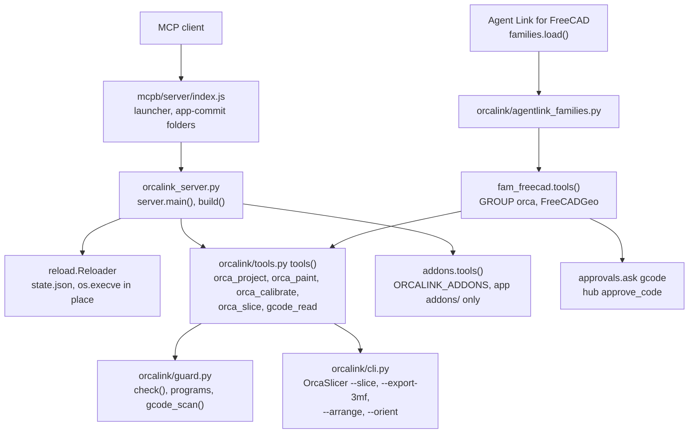

# How Agent Link for OrcaSlicer works
<!-- SPDX-License-Identifier: LGPL-2.1-or-later -->

Agent Link for OrcaSlicer (OrcaLink) works in two ways:

- as its own MCP server over stdio (`orcalink_server.py`), with no FreeCAD;
- as an add-on of Agent Link for FreeCAD (the hub): the FreeCAD family `orca`.

Both use the same tools in `orcalink/tools.py`. This page tells how each way runs. The hub's own flow is in [the hub's workflow pages](https://github.com/jamesK1000011/AgentLink-FreeCAD/blob/main/docs/workflow/README.md).

## Its own stdio server

- `orcalink_server.py` runs `orcalink/server.py` `main()`. It is plain Python 3.9+. It opens no network port.
- `build(out_dir)` makes the tools: `guide_read`, `orca_status`, the tools of `orcalink/tools.py` `tools()` (`orca_project`, `orca_paint`, `orca_calibrate`, `orca_slice`, `gcode_read`), and the tools of installed add-ons (`addons.tools()`).
- `serve_lines()` reads one JSON-RPC line at a time and writes one answer line. Stray prints go to stderr.
- Without a host, `approve` is `None`. So G-code that needs the person's approval is refused (`not_allowed`). The person adds it in OrcaSlicer's own window.

## The app copy and the reload in place

- The extension's launcher (`mcpb/server/index.js`) keeps each version in a folder of its own: `~/.config/orcaslicer-agentlink/app-<commit>`. `state.json` there names the version to serve (`current`).
- A new version comes from the launcher's own update at a start, or from the hub's `agentlink_update`. The hub's launcher puts the installed copy there (`publishStdio()`, the `stdio` entry in the hub's `packaging/addons.json`).
- Between two calls, `reload.Reloader.newer()` compares `current` with this process's own version (`ORCALINK_VERSION`). It also compares `addons/.id` in the app folder.
- When they differ and the new folder's server builds (`_loads()`), `Reloader.go()` starts the new code in place with `os.execve`. The process, and so the pipes to the client, stay. The client does not send `initialize` again, so its parameters and any input already read go to the new process in a hand-off file (`take_handoff()`).
- A checkout (`ORCALINK_FROM`, or version `local`) is never swapped. `ORCALINK_UPDATE=false` turns the reload off.

## Add-ons of this server

`orcalink/addons.py` finds add-ons by convention: a package that holds `orcalink_addon.py`. It looks only in two places:

- the folders that `ORCALINK_ADDONS` lists;
- each child folder of `addons/` in this app copy (`APP_ADDONS`). The hub's launcher puts the pinned add-ons there (`serverAddons` in the hub's `packaging/addons.json`).

It never searches the Python path or a folder that the agent can write. No tool writes into the app copy (`addons.inside_app()`). An add-on that is not installed adds no tool and costs no tokens. An add-on that fails to load is left out, and the server still starts.

## The path guard

`orcalink/guard.py` holds the checks that every tool shares:

- `check()`: no read or write in a secret folder (`.ssh`, `.aws`, `.gnupg`, `.config` and others). In `~/Library`, reads only in the slicers' own preset folders. Writes only in the output folder, the home folder or the temporary folder; never in a hidden folder, never in the app copy, never a script or a program, never through a link; only with the expected extension; over a file only with `overwrite`.
- `refuse_programs()` and `empty_programs()`: the slicer keys that name a program or a plug-in (`post_process`, `plugins`, `slicing_pipeline_plugin`) are refused when set, and emptied before a slicer reads a project or a profile.
- `gcode_scan()`: G-code that changes the printer, heats over the caps, or turns the motors or the power off mid-print is found in every G-code text that a tool writes. It needs the person's approval.
- `text()` and `tilde()`: text from files goes to the agent without invisible characters and capped. Paths under the home folder show as `~/…`.

## How OrcaSlicer's command line is driven

`orcalink/cli.py` drives the slicers' command lines. Workshop for FreeCAD's Make slices through this same module.

- `find()` finds OrcaSlicer: `AGENTLINK_ORCASLICER`, then the program names on the path, then `/Applications/OrcaSlicer.app`.
- `_run()` runs the command line with a time limit (`subprocess.run`). If the run fails, there is no display, and `xvfb-run` is installed, it tries again under `xvfb-run`.
- `window_open()` reads `ps` for OrcaSlicer's own window. If the window is open or holds its lock, the call answers busy (`SlicerBusy`) and changes nothing.
- `slice_project()` slices a project: `--slice <plate> --outputdir <folder>`, with `--export-3mf` when asked. It slices a copy with the program keys emptied (`_Clean`). The person's file is not changed.
- `slice_with()` slices meshes: `--slice 0 --load-settings <machine>;<process> --load-filaments … --outputdir …`, with `--arrange` and `--orient` when asked.
- `make_project()` and `relayout()` build or arrange a project with `--arrange`, `--orient` and `--export-3mf`.

## The FreeCAD family

- The hub loads `orcalink/agentlink_families.py` by convention. It never names this package. `AGENTLINK_API = ">=1,<2"`.
- `orcalink/fam_freecad.py` is the family: `GROUP = "orca"`. It is not in the lean list.
- `fam_freecad.tools(session)` calls `tools.tools()` with `geo_for(session, …)`. The tools then work on FreeCAD's bodies and faces: projects made from bodies, painted by face, meshes from FreeCAD's kernel.
- `wrap()` turns OrcaLink's refusals into the hub's `ToolError` with the same code and words. Paths show as `~/…`.
- `_guides()` registers `orcalink/freecad_guides` for `guide_read { topic: "orca" }`. The search words go to the hub's tool index (`toolindex.declare()`).
- In FreeCAD, each path also goes through the hub's own path guard first.

## Approvals

- In FreeCAD, risky G-code asks the hub's approval: `approvals.ask("gcode", name, what, lines, fingerprint, shown={"source": name})`. The fingerprint is a SHA-256 of the name and the lines. `force: true` is never an approval.
- **Note.** At the hub commit of this page, `gcode` is not one of the hub's approval kinds (`approvals.KINDS`). The hub refuses that ask (`invalid_input`), so the risky G-code is not written.
- Alone, the server refuses such G-code (`not_allowed`).

## Diagram

